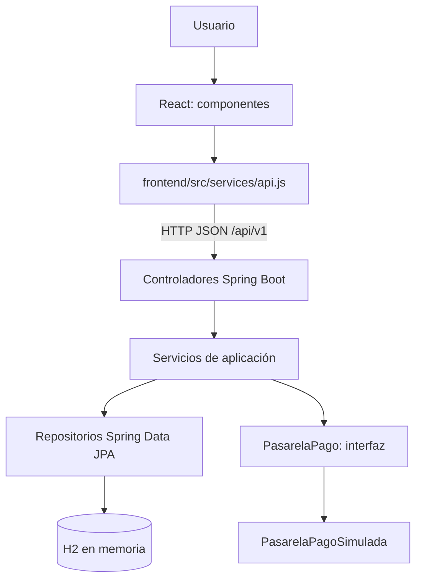

# SmartTicket — Sistema de venta de entradas y control de acceso

Proyecto académico del **Trabajo Práctico 9 de Programación Orientada a Objetos (UADER — FCyT)**, centrado en la aplicación de **GRASP y SOLID**. Implementa una API REST con Java y Spring Boot, una interfaz web con React y Vite, y una base de datos H2 para demostraciones locales.

El sistema cubre el recorrido de un espectador: **cotizar entradas → realizar un pago simulado → obtener identificadores de acceso → validar el ingreso**. Incluye operaciones CRUD para preparar el dominio y un Explorador de consultas para inspeccionar ventas e inventario.

> **Alcance académico:** los pagos son simulados, el “QR” es un identificador de texto (UUID), la base de datos es temporal y no hay autenticación/autorización. **No es una plataforma preparada para producción ni para aceptar pagos reales.**

## Contenido

- [Funcionalidades](#funcionalidades)
- [Tecnologías](#tecnologías)
- [Estructura del repositorio](#estructura-del-repositorio)
- [Requisitos y ejecución local](#requisitos-y-ejecución-local)
- [Demostración del flujo completo](#demostración-del-flujo-completo)
- [API REST principal](#api-rest-principal)
- [Modelo del dominio](#modelo-del-dominio)
- [Arquitectura y decisiones de diseño](#arquitectura-y-decisiones-de-diseño)
- [Pruebas](#pruebas)
- [Limitaciones y mejoras posibles](#limitaciones-y-mejoras-posibles)
- [Documentación complementaria](#documentación-complementaria)

## Funcionalidades

| Módulo | Qué permite hacer | Estado |
|---|---|---|
| Administración del dominio | Crear, consultar, actualizar y eliminar lugares, sectores, eventos y clientes, respetando las restricciones del negocio | Implementado |
| Configuración de eventos | Definir el precio de **cada sector para un evento específico** y generar automáticamente sus entradas según la capacidad | Implementado |
| **HU 1 — Selección y cotización** | Seleccionar evento, sector y cantidad; comprobar entradas disponibles y calcular precio sin reservar inventario | Implementado en Java y React |
| **HU 2 — Pago y emisión** | Simular pago aprobado/rechazado, registrar una venta pagada y cambiar las entradas a `EMITIDA` | Implementado en Java y React |
| **HU 3 — Control de acceso** | Validar un código, verificar pago y fecha del evento, impedir duplicados y registrar la hora de ingreso | Implementado en Java y React |
| **Explorador** | Consultar eventos, sectores, clientes, inventarios, ventas y entradas; paginar listados y filtrar entradas por evento | Implementado en Java y React |
| Webhook de pagos | `POST /api/v1/pagos/webhook-pagos` | **No implementado** (`501 Not Implemented`) |

### Comportamiento importante

- **Cotización:** cuenta entradas con estado `DISPONIBLE`; no modifica el inventario y no garantiza stock futuro.
- **Pago:** vuelve a validar disponibilidad *antes* de consultar la pasarela simulada. Solo los pagos `APROBADA` generan una `Venta` con estado `PAGADA` y entradas `EMITIDA`. Los pagos `RECHAZADA` no emiten entradas.
- **Acceso:** únicamente admite entradas `EMITIDA` asociadas a una venta `PAGADA` y a un evento cuya fecha sea la del día del escaneo. Al aprobarse, la entrada pasa a `UTILIZADA` y se registra `fechaHoraIngreso`.
- **Prevención de duplicados:** el backend utiliza transacciones y bloqueos pesimistas para coordinar compras y accesos simultáneos.
- **Explorador:** sus endpoints agregados de entradas y ventas son de solo lectura, con páginas de hasta 50 registros; los listados no incluyen los códigos QR.

## Tecnologías

| Área | Tecnología |
|---|---|
| Backend | Java 21, Spring Boot 3.5.16, Spring Web |
| Persistencia | Spring Data JPA, Hibernate, H2 en memoria |
| Validación y documentación | Jakarta Bean Validation, Swagger/OpenAPI (`springdoc`) |
| Gestión y pruebas Java | Maven, Spring Boot Test, JUnit |
| Frontend | React 18, JavaScript, Vite 5, CSS |
| Pruebas del frontend | `node --test` (sin framework de test adicional) |
| Comunicación | API REST JSON; proxy de Vite `/api` → `localhost:8080` durante el desarrollo |

## Estructura del repositorio

```text
.
├── pom.xml
├── src/
│   ├── main/
│   │   ├── java/com/smartticket/
│   │   │   ├── config/        # Swagger y reloj/zona horaria
│   │   │   ├── controller/    # Entrada de solicitudes REST
│   │   │   ├── dto/           # Datos de entrada y salida de la API
│   │   │   ├── exception/     # Errores y respuestas HTTP
│   │   │   ├── model/         # Entidades y estados del dominio
│   │   │   ├── repository/    # Persistencia JPA
│   │   │   └── service/       # Casos de uso y reglas de negocio
│   │   └── resources/application.properties
│   └── test/                 # Pruebas del backend
├── frontend/
│   ├── src/
│   │   ├── components/       # Cotización, Pago, Acceso y Explorador
│   │   ├── services/api.js   # Cliente REST compartido
│   │   ├── utils/            # Validaciones y formato para la UI
│   │   └── App.jsx
│   ├── tests/                # Pruebas del frontend
│   ├── package.json
│   └── vite.config.js
├── docs/
│   └── GRASP_SOLID.md
└── README.md
```

## Requisitos y ejecución local

Necesitás **JDK 21 o compatible con el proyecto**, **Maven**, **Node.js compatible con Vite 5** y **npm**. Se recomienda VSCode y dos terminales integradas. Los comandos siguientes están preparados para **PowerShell de Windows**.

### 1. Iniciar el backend

Abrí la **primera terminal en la carpeta donde está `pom.xml`**, nunca dentro de `src/`:

```powershell
java -version
mvn -version
mvn spring-boot:run
```

El backend inicia en **http://localhost:8080**. Mantené esa terminal abierta.

### 2. Iniciar el frontend

Abrí una **segunda terminal de VSCode** desde la misma carpeta y ejecutá:

```powershell
cd frontend
npm.cmd ci
npm.cmd run dev
```

- `npm.cmd ci` instala las dependencias del `package-lock.json`. Es necesario al comenzar o después de cambios de dependencias; **no hace falta repetirlo en cada inicio**.
- En esta configuración de PowerShell se utiliza **`npm.cmd`** en lugar de `npm`, para evitar el bloqueo de `npm.ps1` por la política de ejecución.
- El frontend se abre en **http://localhost:5173** y utiliza el proxy configurado en `frontend/vite.config.js` para acceder a Spring Boot.
- El proxy es una configuración de **desarrollo**, no una solución de despliegue para producción.

### 3. Direcciones útiles

| Recurso | URL |
|---|---|
| Aplicación React | http://localhost:5173 |
| Swagger UI | http://localhost:8080/swagger-ui.html |
| Comprobación de estado | http://localhost:8080/api/v1/estado |
| Consola H2 | http://localhost:8080/h2-console |

**Consola H2:** usuario `sa`, contraseña vacía y JDBC URL:

```text
jdbc:h2:mem:smartticket;DB_CLOSE_DELAY=-1;DB_CLOSE_ON_EXIT=FALSE
```

La base de datos se aloja en memoria: **los datos se pierden al detener y reiniciar Spring Boot**. No hay un usuario o evento precargado para la demo; deben crearse con la API.

## Demostración del flujo completo

Prepará los datos iniciales en **Swagger UI**. Los IDs siguientes son ejemplos: utilizá los que devuelva tu ejecución.

**1. Crear un lugar** — `POST /api/v1/lugares`:

```json
{"nombre":"Estadio Central","direccion":"Av. Principal 123"}
```

**2. Crear un sector** — `POST /api/v1/sectores`:

```json
{"nombre":"Platea","capacidadMaxima":3,"lugarId":1}
```

**3. Crear un evento** — `POST /api/v1/eventos`:

```json
{
  "nombre":"Rock Fest",
  "fechaHora":"AAAA-MM-DDT21:00:00",
  "lugarId":1,
  "preciosSectores":[{"sectorId":1,"precio":12000.00}]
}
```

Reemplazá `AAAA-MM-DD` por la fecha **en la que hacés la prueba** (podés consultar `Get-Date -Format 'yyyy-MM-dd'` en PowerShell). El control de acceso valida que el evento corresponda a ese día. Si el lugar tiene más sectores, indicá un precio para **cada** sector.

**4. Crear un cliente** — `POST /api/v1/clientes`:

```json
{"nombre":"Ana Perez","email":"ana.demo@example.com"}
```

**5. Probar desde React:**

1. En **Cotización**, seleccioná Rock Fest, Platea y 2 entradas. El total esperado es **$24.000** y el inventario sigue intacto.
2. Presioná **Continuar a pago simulado**, elegí el cliente y `APROBADA`. Se registra una venta `PAGADA` y se emiten 2 entradas con `codigoQR` de texto.
3. En el comprobante, elegí **Probar acceso con esta entrada** y validá uno de los códigos. Si el evento es de hoy, se marcará `UTILIZADA` y aparecerá la hora de ingreso.
4. Volvé a escanear el mismo código: el sistema debe **rechazar el ingreso duplicado**.
5. Abrí **Explorador** y comprobá el estado de las entradas, los totales y la venta registrada.

Los identificadores `codigoQR` **no son imágenes QR**; en esta versión se copian o ingresan como texto. Los pagos se prueban exclusivamente con `APROBADA` y `RECHAZADA`, **nunca con datos bancarios reales**.

## API REST principal

Todas las rutas comienzan con `/api/v1`.

| Método | Ruta | Uso |
|---|---|---|
| `GET` | `/estado` | Consultar estado del servicio |
| `GET`, `POST` | `/lugares`, `/sectores`, `/eventos`, `/clientes` | Listar y crear datos del dominio |
| `GET`, `PUT`, `DELETE` | `/{recurso}/{id}` | Consultar, editar y eliminar un registro del CRUD correspondiente |
| `GET` | `/eventos/{id}/inventario` | Obtener precios, capacidad y cantidades por estado |
| `POST` | `/cotizaciones/cotizar` | Validar stock y calcular el precio sin reservar |
| `POST` | `/pagos/iniciar-pago` | Simular pago y emitir entradas |
| `POST` | `/accesos/escanear-acceso` | Validar código y registrar ingreso |
| `GET` | `/explorador/ventas?pagina=0&tamano=10` | Consultar ventas paginadas |
| `GET` | `/explorador/entradas?pagina=0&tamano=10&eventoId=1` | Consultar entradas paginadas; `eventoId` es opcional |
| `POST` | `/pagos/webhook-pagos` | **Pendiente**; responde HTTP 501 |

Los endpoints del Explorador aceptan `pagina >= 0` y `1 <= tamano <= 50`. Consultá **Swagger** para los DTO, los campos obligatorios, los códigos HTTP y todos los detalles de cada operación.

## Modelo del dominio

| Entidad | Responsabilidad en el modelo |
|---|---|
| `Lugar` | Representa el lugar físico donde se realizan eventos |
| `Sector` | Pertenece a un lugar y define su capacidad máxima |
| `Evento` | Tiene un lugar y una fecha/hora |
| `PrecioSector` | Relaciona un evento con uno de sus sectores y el precio aplicable **a ese evento** |
| `Entrada` | Pertenece a un evento/sector, conserva estado, código y hora de ingreso; puede asociarse a una venta |
| `Cliente` | Representa al comprador |
| `Venta` | Conserva el cliente, total y estado del pago; las entradas la referencian mediante `Entrada.venta` |

**Estados de `Entrada`:** `DISPONIBLE`, `RESERVADA`, `EMITIDA`, `UTILIZADA`. **Estados de `Venta`:** `PENDIENTE`, `PAGADA`, `CANCELADA`.

La creación de un evento genera un número de entradas acorde a la capacidad de cada sector. El código UUID se asigna en ese momento, pero **no habilita acceso** mientras la entrada no esté emitida y la venta no esté pagada.

## Arquitectura y decisiones de diseño



El frontend se encarga de la presentación y llama a la API, **no modifica directamente H2 ni calcula el total final**. Los controladores reciben las solicitudes y delegan en servicios. Los servicios validan el negocio y utilizan repositorios JPA.

Ejemplos presentes en el código:

- **SRP / Controlador GRASP:** `CotizacionController`, `PagoController` y `AccesoController` delegan los casos de uso a sus servicios.
- **Alta cohesión y bajo acoplamiento:** `CotizacionService`, `PagoService`, `AccesoService` y `ExploradorService` tienen responsabilidades diferenciadas; reciben sus dependencias por constructor.
- **DIP / Variaciones Protegidas:** `PagoService` depende de `PasarelaPago` y utiliza una implementación `PasarelaPagoSimulada` inyectada por Spring.
- **Información y reglas:** `PrecioSector` contiene el precio de la combinación evento/sector; **los cálculos de cotización y pago se realizan en los servicios**, usando los datos del dominio. No se realiza el cálculo dentro de `PrecioSector`.
- **Consistencia:** `@Transactional` y bloqueos `PESSIMISTIC_WRITE` protegen compras e ingresos; el Explorador usa `@Transactional(readOnly = true)`.
- **Errores controlados:** `ApiExceptionHandler` convierte excepciones de negocio y validación en respuestas HTTP coherentes.

Para consultar el análisis de patrones GRASP y principios SOLID aplicado a las clases del proyecto, junto con ejemplos de código, alcance de la implementación y posibles mejoras, revisá **[GRASP y SOLID](docs/GRASP_SOLID.md)**.

## Pruebas

Desde la raíz del proyecto, donde está `pom.xml`:

```powershell
mvn clean test
```

Desde una segunda terminal, ubicada en `frontend/`:

```powershell
cd frontend
npm.cmd run test
npm.cmd run build
```

El proyecto incluye pruebas para CRUD, cotización, pago, control de acceso, concurrencia y Explorador, además de tests del cliente REST y utilidades del frontend. En la copia de la Etapa 4.5 revisada para esta documentación hay **46 métodos Java con `@Test`** y **31 pruebas del frontend**; estos recuentos pueden cambiar si se amplía el proyecto. Ejecutá los comandos anteriores para comprobar el estado de tu copia local.

Las pruebas Java utilizan configuración H2 específica de test para aislar los datos. La compilación del frontend es independiente de las pruebas del backend.

## Limitaciones y mejoras posibles

Esta entrega funciona como **prototipo académico local**. Entre los aspectos pendientes para un sistema real:

- Agregar autenticación, autorización y protección de datos personales; **el Explorador y las operaciones administrativas no están protegidos**.
- Sustituir H2 en memoria por persistencia duradera, con migraciones de esquema y gestión de configuración por entorno.
- Integrar pagos reales mediante un proveedor confiable, manejar operaciones asíncronas y completar el webhook; no mantener una transacción de base de datos abierta durante una operación de red real.
- Convertir los códigos de texto en QR visuales escaneables y diseñar el control físico de ingreso.
- Configurar seguridad, CORS, HTTPS, secretos, observabilidad y despliegue para producción.

## Documentación complementaria

- **[GRASP y SOLID](docs/GRASP_SOLID.md)** — patrones y principios de diseño aplicados a SmartTicket, con ejemplos de clases, arquitectura, decisiones técnicas y limitaciones.
- **[Frontend: instalación y funcionamiento](frontend/README.md)** — comandos de React + Vite y pestañas disponibles.
- **[Guía de la Etapa 4.5](GUIA_ETAPA4_5.md)** — detalles de integración del Explorador.
- **[Guía de la Etapa 4.3](GUIA_ETAPA4_3.md)** y **[Guía de la Etapa 4.4](GUIA_ETAPA4_4.md)** — documentación histórica de las integraciones de Pago y Acceso.

---

**SmartTicket — TP 9 · GRASP y SOLID aplicados · UADER — FCyT.**
