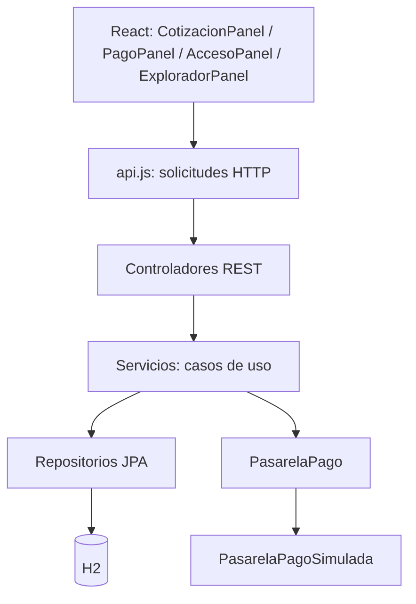
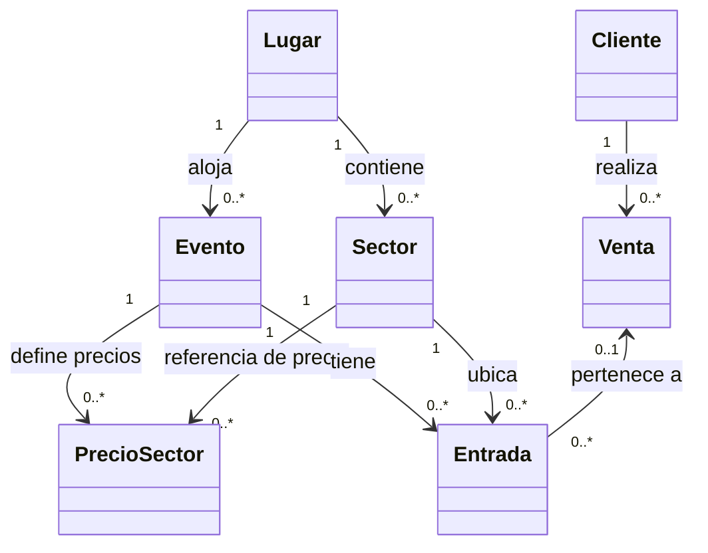

# SmartTicket — Aplicación de GRASP y SOLID

**TP 9 · Programación Orientada a Objetos · UADER — FCyT**  
**Código analizado:** SmartTicket hasta la **Etapa 4.5** (backend Spring Boot, frontend React y Explorador REST).

Este documento describe **las decisiones de diseño implementadas** en SmartTicket. Relaciona los patrones GRASP y los principios SOLID con clases concretas, detalla el funcionamiento del sistema y distingue las aplicaciones claras de las parciales.

## Índice

1. [Descripción general del sistema](#1-descripción-general-del-sistema)
2. [Arquitectura y distribución de responsabilidades](#2-arquitectura-y-distribución-de-responsabilidades)
3. [GRASP aplicado a SmartTicket](#3-grasp-aplicado-a-smartticket)
4. [SOLID aplicado a SmartTicket](#4-solid-aplicado-a-smartticket)
5. [Las tres Historias de Usuario paso a paso](#5-las-tres-historias-de-usuario-paso-a-paso)
6. [Concurrencia, transacciones y programación defensiva](#6-concurrencia-transacciones-y-programación-defensiva)
7. [Relaciones del dominio](#7-relaciones-del-dominio)
8. [Limitaciones y posibles mejoras](#8-limitaciones-y-posibles-mejoras)

---

## 1. Descripción general del sistema

**¿Qué es SmartTicket?** Un sistema académico de venta y validación de entradas para eventos. Un organizador registra un lugar, sus sectores y un evento; el precio se establece **por evento y sector**. Se crean las entradas según la capacidad. Un espectador cotiza, realiza un **pago simulado** y recibe identificadores QR de texto. En la puerta se comprueba que la entrada esté emitida, pagada y que el evento sea de ese día. Si cumple, se registra un solo ingreso.

### Objetos más relevantes

| Clase | Qué información posee |
|---|---|
| `Lugar` | `id`, `nombre`, `direccion` |
| `Sector` | `nombre`, `capacidadMaxima`, referencia a `Lugar` |
| `Evento` | `nombre`, `fechaHora`, referencia a `Lugar` |
| `PrecioSector` | Referencias a `Evento` y `Sector`, y su `precio` |
| `Entrada` | Evento, sector, venta opcional, estado, `codigoQR`, `fechaHoraIngreso` |
| `Cliente` | Nombre y email |
| `Venta` | Cliente, estado y total |

Dos distinciones importantes del modelo:

- **El precio no pertenece a `Sector`:** Platea puede costar $12.000 en un recital y $8.000 en otro. La clase `PrecioSector` modela precisamente la asociación `(Evento, Sector, precio)` y tiene una restricción de unicidad por evento/sector.
- **La capacidad no es lo mismo que la disponibilidad:** `Sector.capacidadMaxima` indica la capacidad física. La disponibilidad se obtiene contando entradas del evento y sector cuyo estado es `DISPONIBLE`. Un sector con 100 plazas puede tener solo 3 entradas disponibles.

## 2. Arquitectura y distribución de responsabilidades



| Capa | Ejemplos de clases/archivos | Responsabilidad principal |
|---|---|---|
| Presentación | `CotizacionPanel.jsx`, `PagoPanel.jsx`, `AccesoPanel.jsx`, `ExploradorPanel.jsx` | Interacción, formularios y visualización; no gobierna la integridad del negocio |
| Cliente HTTP | `frontend/src/services/api.js` | Construir peticiones REST, interpretar respuestas y comunicar errores |
| Controladores | `CotizacionController`, `PagoController`, `AccesoController`, `ExploradorController` | Exponer rutas, recibir DTO, invocar el caso de uso y devolver HTTP |
| Aplicación / negocio | `CotizacionService`, `PagoService`, `AccesoService`, `ExploradorService`, `EventoService` | Orquestar validaciones, cálculos, estados y transacciones |
| Dominio | `Entrada`, `Venta`, `Evento`, `Sector`, `PrecioSector`, etc. | Conservar los datos, las asociaciones y los estados de las entidades |
| Persistencia | `EntradaRepository`, `PrecioSectorRepository`, etc. | Buscar, contar, bloquear, guardar y recuperar entidades con JPA |
| Integración de pago | `PasarelaPago`, `PasarelaPagoSimulada` | Abstraer y simular la respuesta de un cobro |

**Justificación arquitectónica:** la separación en capas impide concentrar en los componentes React o en los controladores HTTP las reglas de pago y las consultas a la base de datos. Los servicios coordinan los casos de uso y los repositorios gestionan la persistencia.

**Precisión importante:** las entidades actuales son principalmente modelos JPA con atributos y getters/setters. **Las reglas de negocio se concentran en los servicios**, y no en métodos ricos de las entidades. Eso cumple el enfoque por capas del TP, pero es una decisión y una posible mejora, no debe confundirse con un modelo de dominio muy encapsulado.

---

## 3. GRASP aplicado a SmartTicket

GRASP (*General Responsibility Assignment Software Patterns*) ofrece criterios para **asignar responsabilidades entre objetos y clases**. En SmartTicket no todos los patrones se demuestran con la misma fuerza.

### 3.1. Controlador (Controller) — aplicación clara

**Idea:** asignar la recepción de eventos del sistema a un objeto apropiado, sin acumular toda la lógica de negocio en él.

**En el proyecto:**

- `CotizacionController.cotizar(...)` recibe el DTO y delega a `CotizacionService.cotizar(...)`.
- `PagoController.iniciarPago(...)` delega a `PagoService.iniciarPago(...)`.
- `AccesoController.escanearAcceso(...)` delega a `AccesoService.escanear(...)`.
- `ExploradorController` delega consultas a `ExploradorService`.

Ejemplo de la HU 3:

```java
@PostMapping("/escanear-acceso")
public ResponseEntity<AccesoResponse> escanearAcceso(@Valid @RequestBody AccesoRequest datos) {
    return ResponseEntity.ok(servicio.escanear(datos));
}
```

El controlador **no busca entradas en H2 ni cambia sus estados**.

**Consecuencia de mezclar responsabilidades:** si un controlador también validara pagos, calculara importes y gestionara inventario, aumentaría su acoplamiento y sería más difícil probarlo y mantenerlo.

### 3.2. Experto en Información (Information Expert) — aplicación por servicios, con matiz

**Idea:** asignar la responsabilidad a quien dispone de la información necesaria para cumplirla.

**En el proyecto:**

- `Sector` conoce su capacidad máxima y `Evento` su fecha.
- `PrecioSector` guarda el precio correspondiente a un evento y un sector.
- `Entrada` almacena estado, venta asociada y hora de ingreso.
- `CotizacionService` **reúne** el precio persistido y la cantidad disponible para calcular el total.
- `AccesoService` utiliza la información de `Entrada`, `Venta` y `Evento` para decidir si admite el ingreso.

**Responsabilidad efectiva:** `PrecioSector` almacena el precio, pero **no calcula el subtotal**. El código utiliza:

```java
BigDecimal subtotal = precioUnitario.multiply(BigDecimal.valueOf(datos.cantidad()));
```

...dentro de `CotizacionService`. En `PagoService` también se recalcula el total con el precio de base de datos.

**Alcance de la aplicación:** se identifica qué entidades contienen la información necesaria, mientras los servicios coordinan las reglas que abarcan varias entidades. Una posible mejora sería incorporar comportamientos de dominio que refuercen el encapsulamiento.

### 3.3. Alta Cohesión (High Cohesion) — aplicación clara

**Idea:** una clase debería reunir responsabilidades relacionadas entre sí y evitar convertirse en un objeto que hace de todo.

- `CotizacionService` cotiza; no cobra ni habilita accesos.
- `PagoService` verifica stock, simula el cobro y emite entradas; no se encarga del torniquete.
- `AccesoService` valida y registra ingresos; no administra clientes ni precios.
- `ExploradorService` construye respuestas de consulta; no modifica los estados del dominio.

**Ventaja:** un cambio en el proceso de ingreso debería concentrarse principalmente en la HU 3, no obligarnos a rehacer la HU 1.

### 3.4. Bajo Acoplamiento (Low Coupling) — aplicación clara

**Idea:** minimizar dependencias directas innecesarias entre clases.

En Java, los servicios reciben repositorios **por constructor**; no abren conexiones a H2 ni construyen directamente implementaciones de repositorios. `PagoService` trabaja con la interfaz `PasarelaPago`, no necesita conocer una API externa concreta. En React, `api.js` concentra la comunicación HTTP.

**Beneficio:** si cambia la implementación de persistencia o pagos, otras partes necesitan menos modificaciones.

**Matiz:** los servicios siguen dependiendo de los contratos concretos de las entidades y DTO. Bajo acoplamiento significa **reducir** dependencias, no eliminarlas todas.

### 3.5. Indirección (Indirection) — aplicación clara

**Idea:** incorporar un intermediario cuando ayuda a evitar dependencias directas.

El contrato `PasarelaPago` separa `PagoService` de la implementación `PasarelaPagoSimulada`. Spring resuelve la dependencia en tiempo de ejecución. Análogamente, `api.js` actúa como punto intermedio para la comunicación de los componentes React con la API.

**Resultado:** la HU 2 no queda vinculada directamente a un proveedor concreto. `PagoService` solicita el cobro mediante `PasarelaPago` sin conocer los detalles de implementación.

### 3.6. Polimorfismo (Polymorphism) — ejemplo acotado

`PasarelaPago` declara:

```java
public interface PasarelaPago {
    boolean cobrar(String tarjetaDePrueba, BigDecimal monto);
}
```

`PasarelaPagoSimulada` implementa `cobrar(...)`. `PagoService` invoca la interfaz y no necesita usar condicionales para distinguir una clase simulada de una real.

**Matiz:** hoy existe **una sola implementación concreta**. Hay una extensión polimórfica preparada, pero no hay en esta versión varias pasarelas intercambiables para demostrarla dinámicamente.

### 3.7. Variaciones Protegidas (Protected Variations) — aplicación clara en pagos

**Idea:** identificar puntos que pueden cambiar y proteger al sistema frente a esa variación mediante contratos estables.

En SmartTicket, el mecanismo de pago es una variación probable. `PagoService` depende de `PasarelaPago`, que podría tener otra implementación para un proveedor futuro.

**No confundir:** Variaciones Protegidas **no significa** poner contraseñas al código fuente. Se trata de aislar cambios de diseño.

### 3.8. Fabricación Pura (Pure Fabrication) — interpretación adecuada

**Idea:** introducir una clase técnica o de servicio que no sea un concepto del dominio, cuando eso mejora cohesión y acoplamiento.

`CotizacionService`, `PagoService` y `ExploradorService` no representan un estadio, entrada o cliente; coordinan operaciones para que ni las entidades ni los controladores concentren demasiadas tareas. Son ejemplos razonables de **servicios de aplicación** que cumplen esta finalidad.

### 3.9. Creador (Creator) — aplicación parcial

**Idea:** decidir quién debería crear los objetos según su relación y la información que posee.

- `EventoService.crear(...)` construye `Evento` y coordina la creación de `PrecioSector` y las `Entrada` correspondientes.
- `PagoService.iniciarPago(...)` construye una `Venta` al aprobarse la pasarela.

**Matiz de diseño:** esta creación se asignó a **servicios de aplicación** porque se necesita coordinar repositorios y una transacción. No existe una fábrica de dominio independiente ni se aplica de manera literal el patrón Creator asignando siempre la responsabilidad al objeto agregado.

### Resumen GRASP

| Patrón | Evidencia principal | Nivel de evidencia |
|---|---|---|
| Controlador | `CotizacionController`, `PagoController`, `AccesoController` | Clara |
| Experto en Información | Datos en entidades, decisiones coordinadas en servicios | Parcial / distribuida |
| Alta Cohesión | Servicios separados por caso de uso | Clara |
| Bajo Acoplamiento | Inyección de repositorios e interfaz de pago | Clara |
| Indirección | `PasarelaPago` y `api.js` | Clara |
| Polimorfismo | `PasarelaPagoSimulada implements PasarelaPago` | Ejemplo acotado |
| Variaciones Protegidas | Interfaz ante cambios del proveedor de pago | Clara |
| Fabricación Pura | Servicios técnicos/de aplicación | Razonable |
| Creador | Creación de objetos en `EventoService` y `PagoService` | Parcial |

---

## 4. SOLID aplicado a SmartTicket

SOLID agrupa cinco principios orientados a clases, contratos y dependencias. A continuación se identifica **la evidencia en el código y el alcance real** de cada uno.

### S — Single Responsibility Principle (SRP) / Responsabilidad Única

**Definición:** una clase debe tener un motivo de cambio principal relacionado con su responsabilidad.

**Ejemplos:**

- `AccesoController` recibe la solicitud HTTP; `AccesoService` decide y registra el ingreso; `EntradaRepository` busca y bloquea la entidad.
- `ExploradorService` solo construye respuestas de lectura para el Explorador.
- `frontend/src/services/api.js` centraliza el intercambio HTTP, mientras `AccesoPanel.jsx` presenta el formulario y el resultado.

**Separación de cambios:** los ajustes visuales corresponden al frontend; las reglas de ingreso se concentran en `AccesoService`; y los cambios en consultas de persistencia afectan principalmente al repositorio.

**Matiz:** `EventoService` combina creación, inventario, edición y borrado de eventos; tiene una responsabilidad de alto nivel coherente, pero podría dividirse si la complejidad creciera.

### O — Open/Closed Principle (OCP) / Abierto para extensión, cerrado para modificación

**Definición:** una parte del sistema debería poder extenderse en ciertos puntos sin alterar el código de negocio existente.

**Ejemplo mejor sustentado:** podría implementarse `PasarelaPagoReal implements PasarelaPago` y conservarse la llamada `pasarela.cobrar(...)` de `PagoService`.

**Limitación:** hoy no hay segunda pasarela. Además, si conviven dos implementaciones como componentes Spring, sería necesario decidir cuál inyectar (`@Primary`, `@Qualifier` o configuración). **El principio no se aplica universalmente:** otras reglas, como los estados admitidos o el proceso de emisión, pueden requerir modificaciones en servicios existentes.

### L — Liskov Substitution Principle (LSP) / Sustitución de Liskov

**Definición:** una implementación de un contrato debe poder sustituir a otra sin romper las expectativas del consumidor.

**Relación con el código:** `PasarelaPagoSimulada` cumple el método definido en `PasarelaPago`. `PagoService` puede consumir el contrato sin depender de una clase concreta.

**Limitación:** al tener una única implementación, **no se comprueba una sustitución entre varios proveedores**. Para cumplir LSP, las futuras implementaciones deberán mantener el significado del contrato (por ejemplo, cuándo devolver éxito o rechazo) sin introducir comportamientos incompatibles.

**No confundir:** que exista una interfaz por sí solo no demuestra automáticamente un diseño conforme a LSP en todos sus aspectos.

### I — Interface Segregation Principle (ISP) / Segregación de Interfaces

**Definición:** un cliente no debería depender de operaciones que no necesita.

`PasarelaPago` es una interfaz pequeña que expone únicamente `cobrar(...)`. `PagoService` no tiene que implementar ni conocer operaciones de un proveedor que no utilice.

**Limitación:** no había en el código una gran interfaz que necesitáramos dividir. Por eso ISP está **ilustrado por un contrato acotado**, no validado mediante una refactorización de varias interfaces.

### D — Dependency Inversion Principle (DIP) / Inversión de Dependencias

**Definición:** los módulos de alto nivel no deberían quedar atados a detalles concretos; ambos deberían depender de abstracciones adecuadas.

**Es el ejemplo SOLID más claro del proyecto.** `PagoService` contiene:

```java
private final PasarelaPago pasarela;
```

Su constructor recibe `PasarelaPago`, y Spring puede inyectar `PasarelaPagoSimulada`. Así, el servicio no instancia `new PasarelaPagoSimulada()` ni depende del nombre de una pasarela comercial.

**Importante:** **inyección de dependencias (DI)** es el mecanismo de proporcionar dependencias; **DIP** es el principio arquitectónico de depender de abstracciones. Se relacionan, pero **no son sinónimos**. También se inyectan repositorios Spring Data, que son interfaces de persistencia.

### Resumen SOLID

| Principio | Evidencia en el código | Alcance de la aplicación |
|---|---|---|
| SRP | `AccesoController`, `AccesoService`, `EntradaRepository` | Separación de HTTP, reglas y persistencia |
| OCP | `PasarelaPago`, `PagoService` | Posibilidad de ampliar el mecanismo de pago sin modificar el servicio consumidor; no es universal |
| LSP | `PasarelaPagoSimulada` | Debe respetar el contrato; evidencia parcial porque hay una sola implementación |
| ISP | `PasarelaPago` | Interfaz breve, con un método requerido por su cliente |
| DIP | `PagoService` + `PasarelaPago` | Dependencia explícita de una abstracción, inyectada por constructor |

---

## 5. Las tres Historias de Usuario paso a paso

### HU 1 — Selección y cotización

**Recorrido real:** `CotizacionPanel.jsx` → `api.cotizar` → `CotizacionController` → `CotizacionService` → `EventoRepository`, `PrecioSectorRepository`, `EntradaRepository` → respuesta.

1. Recibe `eventoId`, `sectorId` y `cantidad`.
2. Rechaza inmediatamente una cantidad menor o igual a cero.
3. Comprueba que el evento exista y que haya un precio para el sector en ese evento.
4. Cuenta las entradas `DISPONIBLE` de ese evento/sector.
5. Si hay suficientes, calcula `precioUnitario × cantidad` con `BigDecimal`.
6. Devuelve cotización. **No cambia el estado de las entradas**.

**Por qué `BigDecimal`:** permite representar valores monetarios decimales sin los problemas habituales de precisión binaria de `double`.

**Ejemplo:** 2 × $12.000 = **$24.000**. Si se piden 3 y solo queda 1 entrada, retorna un error de validación (`400`).

**Principios relacionados:** Controlador, SRP, Alta Cohesión y uso de información provista por dominio y repositorios.

### HU 2 — Pago simulado y emisión

**Recorrido:** `PagoPanel.jsx` → `api.iniciarPago` → `PagoController` → `PagoService` → `PasarelaPago` / repositorios → comprobante.

1. Verifica cantidad, cliente y evento.
2. Bloquea el registro `PrecioSector` del evento/sector antes de elegir las entradas.
3. Vuelve a consultar entradas `DISPONIBLE`. **Una cotización anterior no reserva stock**.
4. Si el stock ya no existe, responde **409** antes de simular el cobro.
5. Calcula nuevamente el total desde la base de datos; no acepta el total del navegador como autoridad.
6. Invoca `pasarela.cobrar(tarjetaPrueba, total)`.
7. Si `RECHAZADA`, responde **402** y no genera venta exitosa ni cambia entradas.
8. Si `APROBADA`, crea una venta `PAGADA`, asocia las entradas seleccionadas y las marca `EMITIDA`.
9. Devuelve el comprobante y los identificadores `codigoQR` ya generados cuando se creó el evento.

**Principios relacionados:** DIP, Variaciones Protegidas, Polimorfismo por interfaz, Bajo Acoplamiento y SRP.

### HU 3 — Control de acceso por código

**Recorrido:** `AccesoPanel.jsx` → `api.escanearAcceso` → `AccesoController` → `AccesoService` → `EntradaRepository` / datos de `Venta` y `Evento`.

1. Valida que el texto del código no esté vacío.
2. Busca la entrada por `codigoQR` con bloqueo exclusivo.
3. Si no existe, responde **404**.
4. Si ya está `UTILIZADA`, responde **409** y **no sobreescribe** la hora anterior.
5. Si no está `EMITIDA` o no tiene una venta `PAGADA`, responde **403**.
6. Comprueba que la fecha del evento sea la fecha actual en la zona horaria configurada.
7. Registra el ingreso (`UTILIZADA`) y `fechaHoraIngreso`, y responde **200**.

**Principios relacionados:** SRP, Controlador, Alta Cohesión, programación defensiva y Bajo Acoplamiento.

### Explorador — consultas sin modificar el dominio

`ExploradorPanel.jsx` consulta los catálogos y `GET /api/v1/explorador/ventas` y `/entradas` a través de `ExploradorController` y `ExploradorService`. Este último usa `@Transactional(readOnly = true)`, pagina (máximo 50 elementos por página) y construye DTO **sin `codigoQR` ni datos de tarjetas**.

**Decisión:** el explorador **observa** lo que las HU han producido; no emite, cancela ni marca entradas como utilizadas.

---

## 6. Concurrencia, transacciones y programación defensiva

Las HU 2 y HU 3 incorporan control de concurrencia, transacciones y validaciones defensivas para preservar la consistencia de las entradas y las ventas.

### ¿Qué pasa si dos compradores intentan adquirir la última entrada?

En `PrecioSectorRepository` existe una búsqueda con:

```java
@Lock(LockModeType.PESSIMISTIC_WRITE)
```

`PagoService.iniciarPago(...)` bloquea la combinación evento/sector **antes de seleccionar entradas**, en una transacción. Así las compras concurrentes de ese mismo sector se procesan secuencialmente en el motor de base de datos: la segunda operación vuelve a encontrar la disponibilidad actualizada y, si no alcanza, rechaza la compra antes del cobro.

### ¿Qué pasa si dos acomodadores escanean el mismo código?

En `EntradaRepository` se busca por QR con bloqueo de escritura. `AccesoService.escanear(...)` es transaccional. El primer proceso que logra registrar el ingreso deja la entrada en `UTILIZADA`. El siguiente no debería poder autorizar otro ingreso y responde conflicto.

### ¿Por qué usamos `@Transactional`?

Para tratar validaciones y cambios asociados como una única unidad de trabajo: evitar que quede una venta pagada sin emisión correcta o una entrada utilizada sin registrar su hora. **El resultado depende también de las garantías del motor de base de datos** y de la correcta gestión de transacciones.

### ¿Qué es programación defensiva en este proyecto?

- **Fallar rápido:** no aceptar cantidades cero o negativas; rechazar códigos vacíos.
- **Validar antes de cobrar:** si el stock no alcanza, no llamar a la pasarela.
- **No confiar en el cliente:** recalcular el total desde `PrecioSector`.
- **Respetar el estado:** no admitir entradas sin pago o ya utilizadas.
- **Validar formato y contratos:** DTO con validaciones; errores controlados en `ApiExceptionHandler`.
- **Proteger las transiciones:** bloqueos y transacciones para reducir condiciones de carrera.

**Mapeo de errores:** `400` solicitud inválida, `402` pago denegado, `403` acceso no autorizado por falta de emisión/pago, `404` recurso/QR inexistente, `409` conflicto de inventario o ingreso duplicado.

**Límite importante:** la transacción incluye un **cobro simulado, local e inmediato**. Una pasarela real sería una llamada externa no transaccional respecto de H2: habría que cambiar el diseño para soportar reservas, idempotencia, confirmaciones asíncronas y recuperación ante fallas.

---

## 7. Relaciones del dominio



El diagrama muestra **relaciones conceptuales**, no necesariamente colecciones Java en los dos extremos. En el código, por ejemplo, `Entrada` tiene una referencia `Venta venta`, pero `Venta` **no define una lista `List<Entrada>`**: el vínculo se consulta desde las entradas.

- `Sector` → `Lugar`: `@ManyToOne`, obligatorio.
- `Evento` → `Lugar`: `@ManyToOne`, obligatorio.
- `PrecioSector` → `Evento` y `Sector`: dos `@ManyToOne`, con unicidad para la dupla.
- `Entrada` → `Evento` y `Sector`: `@ManyToOne`, obligatorios; `Venta` es opcional (`null` antes de venderse).
- `Venta` → `Cliente`: `@ManyToOne`, obligatorio.

**Composición vs. agregación:** no afirmaría que todas estas relaciones son composición UML. Las referencias JPA `@ManyToOne` describen asociaciones persistentes. Para justificar composición estricta habría que demostrar dependencia fuerte de ciclo de vida y propiedad exclusiva a nivel de modelo. En este código la creación/borrado de entradas de un evento está coordinada por `EventoService`, pero no se implementa mediante una colección con `cascade = ALL` y `orphanRemoval`.


---

## 8. Limitaciones y posibles mejoras

| Aspecto | Estado actual | Mejora razonable |
|---|---|---|
| Encapsulamiento del dominio | Entidades JPA con setters; reglas principalmente en servicios | Añadir métodos de dominio con transiciones válidas, sin romper JPA |
| LSP / OCP | Una interfaz de pago y una implementación simulada | Probar múltiples implementaciones con tests de contrato e inyección explícita |
| Pago y transacciones | El cobro es una operación local ficticia dentro de una transacción | Reservas, idempotencia, webhook real, compensación y confirmaciones asíncronas |
| QR | UUID textual que se introduce o copia | Imagen QR real y lector de cámara, manteniendo validación backend |
| Persistencia | H2 en memoria | Base persistente, migraciones y respaldo |
| Seguridad | Endpoints administrativos y Explorador sin autenticación | Roles, autenticación/autorización y controles de exposición de datos |
| Frontend y despliegue | Vite proxy hacia localhost para desarrollo | Definir URL de API en producción, HTTPS y CORS/control de origen adecuados |

---

**Referencias de código verificables:** `src/main/java/com/smartticket/{controller,service,model,repository,exception}` y `frontend/src/{components,services}`. **Base conceptual:** enunciado del *TP 9 — GRASP y SOLID aplicados* y código de SmartTicket hasta la Etapa 4.5.
